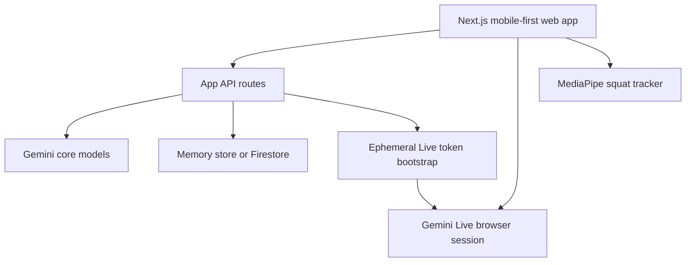

# Swasthya

Swasthya is a mobile-first live wellness coach built for the Gemini Live Agent Challenge. The app combines conversational coaching, camera-based meal analysis, squat tracking, and a Gemini Live recovery call into one focused demo flow.

## What It Does

- Logs meals from the camera with Gemini-based calorie and protein estimates
- Lets the user type naturally to a coach for workout and recovery help
- Tracks squat reps from the laptop camera with visible body keypoints
- Starts a live Gemini voice recovery session with microphone input and spoken output

## Demo Flow

1. Open the app and complete the lightweight setup
2. Tap `Meal` to capture food and log an estimated meal
3. Type a natural coaching message like `I only have 20 minutes today`
4. Tap `Squats` to count reps from the camera
5. Tap `Live` to start a voice recovery session with Gemini Live

## Architecture



### Main Parts

- `apps/web/src/components/swasthya-app.tsx`
  The full mobile-first client experience, including chat, meal camera flow, squat tracker, and live session overlay.
- `apps/web/src/lib/server/gemini.ts`
  Gemini meal parsing, coach response generation, and live model configuration.
- `apps/web/src/app/api/live/session/route.ts`
  Creates the ephemeral Gemini Live session bootstrap payload.
- `apps/web/src/lib/server/store.ts`
  Demo state management for onboarding, meals, workouts, recovery, and coach memory.

## Tech Stack

- Next.js 16
- React 19
- TypeScript
- Framer Motion
- Gemini via `@google/genai`
- MediaPipe pose tracking
- Optional Firestore persistence

## Local Setup

### 1. Install

```bash
npm install
```

### 2. Create env file

Copy `apps/web/.env.example` to `apps/web/.env.local`.

Required for Gemini:

```bash
GEMINI_API_KEY=your_key_here
GOOGLE_GENAI_USE_VERTEXAI=false
GOOGLE_CLOUD_PROJECT=
GOOGLE_CLOUD_LOCATION=us-central1
SWASTHYA_STORE=memory
```

### 3. Run locally

```bash
npm run dev
```

Open `http://localhost:3000`.

## Scripts

```bash
npm run dev
npm run lint
npm run typecheck
npm run build
```

## Deployment

### Vercel

The app can run on Vercel as a standard Next.js deployment.

Required Vercel environment variables:

- `GEMINI_API_KEY`
- `GOOGLE_GENAI_USE_VERTEXAI=false`
- `GOOGLE_CLOUD_LOCATION=us-central1`
- `SWASTHYA_STORE=memory` or `firestore`

### Google Cloud

For hackathon submission proof, deploy the same app to Google Cloud Run and optionally back it with Firestore.

## Notes

- Live voice depends on Gemini Live support for your API key/project.
- Firestore is optional; the app works in demo mode with in-memory state.
- The repo is intentionally focused on the working product path, not extra internal docs.

## License

MIT
