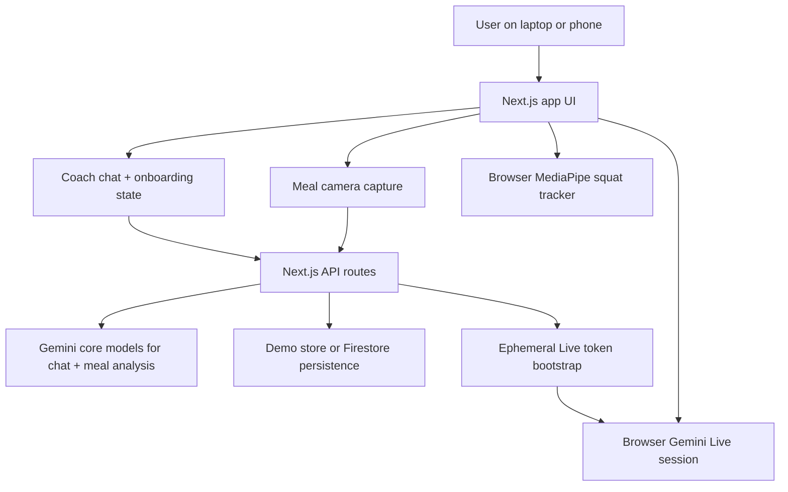

# Swasthya

Swasthya is a mobile-first live wellness coach built for the Gemini Live Agent Challenge. It combines conversational coaching, camera-based meal analysis, squat tracking, daily nutrition logging, and a Gemini Live recovery call into one focused product.

## Problem

Most health apps make the user do all the work:
- manually log meals
- manually interpret plans
- manually stay consistent
- manually restart after a bad day

That breaks down for busy people who want structure but struggle with follow-through.

## Vision

Swasthya turns wellness support into a live agent experience:
- you can **show** your meal instead of typing everything
- you can **talk** to the coach instead of navigating rigid flows
- you can **adapt** workouts in natural language
- you can enter a **live recovery session** that feels proactive and human

The goal is not a broad health super-app. The goal is one polished, believable live wellness coach.

## Core Experience

- Start with a premium onboarding flow that sets goals, training split, and recovery time
- Log meals from the camera with Gemini-based calorie and protein estimates
- Keep a daily calories/protein log and export it as CSV
- Type naturally to a coach for workout, recovery, or meal help
- Track squat reps from the laptop camera with visible body keypoints
- Start a Gemini Live voice recovery session with microphone input and spoken output

## Demo Flow

1. Open the app and complete the lightweight setup
2. Tap `Meal` to capture food and log an estimated meal
3. Type a natural coaching message like `I only have 20 minutes today`
4. Tap `Squats` to count reps from the camera
5. Tap `Live` to start a voice recovery session with Gemini Live

## Architecture



### Main Components

- `apps/web/src/components/swasthya-app.tsx`
  The full mobile-first client experience, including the start screen, onboarding, meal camera flow, squat tracker, daily logs, and live session overlay.
- `apps/web/src/lib/server/gemini.ts`
  Gemini meal parsing, coach response generation, and live model configuration.
- `apps/web/src/app/api/live/session/route.ts`
  Creates the ephemeral Gemini Live session bootstrap payload.
- `apps/web/src/lib/server/store.ts`
  Demo state management for onboarding, meals, workouts, recovery, and coach memory.

## Tech Stack

- Next.js 16
- React 19
- TypeScript
- Framer Motion
- Gemini via `@google/genai`
- MediaPipe pose tracking
- Cloud Run deployment target
- Optional Firestore persistence

## What Judges Can Test

- Meal camera capture and Gemini-based food analysis
- Natural-language coach chat for meals, workouts, and recovery
- Laptop-camera squat rep counting with visible body keypoints
- Gemini Live recovery voice session with microphone input and spoken output
- Daily calorie and protein logging with CSV export

## Setup

### Prerequisites

- Node.js 22 or newer recommended
- A Gemini API key from Google AI Studio
- Optional: Google Cloud project + Firestore if you want persistent state

### 1. Install dependencies

From the repo root:

```bash
npm install
```

### 2. Create the env file

Copy `apps/web/.env.example` to `apps/web/.env.local`.

```bash
GEMINI_API_KEY=your_key_here
GOOGLE_GENAI_USE_VERTEXAI=false
GOOGLE_CLOUD_PROJECT=swasthya-490318
GOOGLE_CLOUD_LOCATION=us-central1
SWASTHYA_STORE=memory
NEXT_PUBLIC_SWASTHYA_SHEETS_URL=
```

Notes:
- `SWASTHYA_STORE=memory` is the fastest local demo mode
- switch to `SWASTHYA_STORE=firestore` only if Firestore credentials are ready
- leave `NEXT_PUBLIC_SWASTHYA_SHEETS_URL` blank unless you want the optional sheet button enabled

### 3. Run locally

```bash
npm run dev
```

Open `http://localhost:3000`.

## Scripts

```bash
npm run dev
npm run lint
npm run typecheck
npm run build
```

## Deployment Notes

### Vercel

The app can run on Vercel as a standard Next.js deployment.

Required Vercel environment variables:

- `GEMINI_API_KEY`
- `GOOGLE_GENAI_USE_VERTEXAI=false`
- `GOOGLE_CLOUD_LOCATION=us-central1`
- `SWASTHYA_STORE=memory` or `firestore`

### Google Cloud

For hackathon submission proof, deploy the same app to Google Cloud Run and optionally back it with Firestore.

Example Cloud Run deploy:

```bash
cd apps/web
gcloud run deploy swasthya \
  --source . \
  --region us-central1 \
  --allow-unauthenticated \
  --set-env-vars="GEMINI_API_KEY=YOUR_KEY,GOOGLE_GENAI_USE_VERTEXAI=false,GOOGLE_CLOUD_PROJECT=swasthya-490318,GOOGLE_CLOUD_LOCATION=us-central1,SWASTHYA_STORE=memory"
```

If you switch to Firestore later, change:

```bash
SWASTHYA_STORE=firestore
```

## Findings and Learnings

- Live voice works best as a browser-direct Gemini Live session with ephemeral token bootstrap, not a fake text-to-speech overlay.
- Meal logging needs both multimodal capture and natural-language fallback to feel believable in a real demo.
- Squat tracking is much more stable when rep counting uses a phase model instead of a single threshold flip.
- A focused mobile-first flow performs better than a dashboard-heavy wellness app for this challenge.

## Why It Fits The Challenge

- Uses Gemini for multimodal meal understanding and conversational coaching
- Uses Gemini Live for the voice recovery session
- Delivers a live-agent interaction rather than a passive chatbot
- Runs on Google Cloud Run for challenge compliance

## Notes

- Live voice depends on Gemini Live support for your API key/project.
- Firestore is optional; the app works in demo mode with in-memory state.
- The repo is intentionally focused on the working product path, not extra internal docs.

## License

MIT
